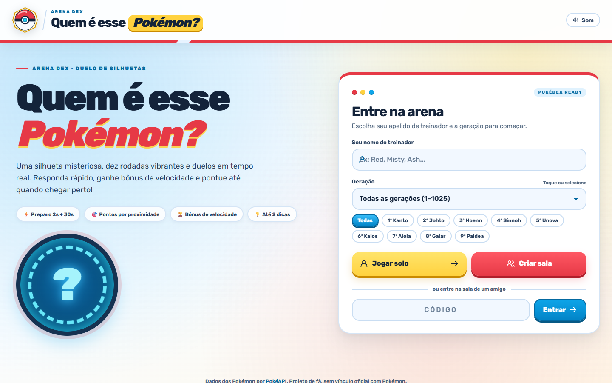
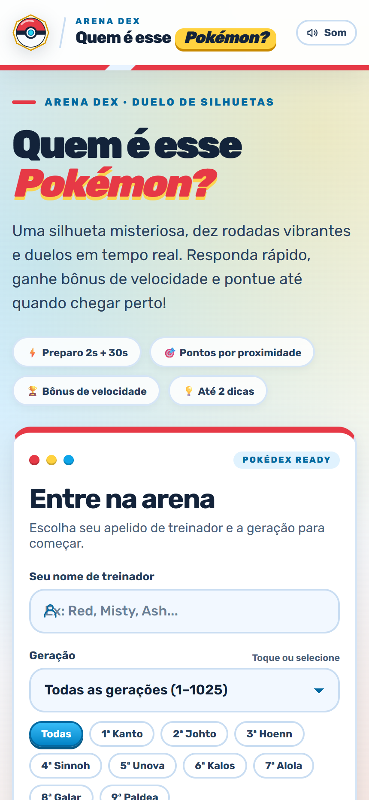

# Arena Dex — Quem é esse Pokémon?

Aplicação web responsiva de duelo de silhuetas Pokémon. Jogue sozinho contra a PokéAPI ou crie uma sala de competição em tempo real com até **8 treinadores** usando código de sala.

🌐 **Acesse em produção:** [https://pokemon.gabrieldagostim.com](https://pokemon.gabrieldagostim.com)



## Recursos Principais

- **Duelo de Silhuetas em 10 Rodadas**: Pokédex radar com preparo inicial de **2 segundos** antes da liberação do turno + **30 segundos** para responder cada Pokémon.
- **Pontuação por Proximidade & Bônus de Velocidade**:
  - Respostas com pequenos erros de digitação recebem pontuação proporcional por proximidade do nome.
  - Em salas multiplayer, o treinador mais rápido em cada rodada conquista bônus de velocidade no placar.
- **Até 2 Dicas Estratégicas**: dicas sob demanda sobre tipo, altura e peso (com ajuste transparente de pontuação).
- **1ª a 9ª Geração (1–1025)**: filtre por geração específica ou jogue com toda a Pokédex nacional.
- **Efeitos Sonoros Sintetizados (Web Audio API)**: feedback sonoro para cliques, acertos, erros e revelação (com botão de silenciar no cabeçalho).
- **Multiplayer Seguro e Temporário**: salas com código de acesso de até 2 horas no Redis (sem necessidade de cadastro). A resposta nunca é enviada ao cliente antes da revelação.

## Telas do Sistema

| Arena de Jogo (Silhueta & Classificação) | Sala de Competição Multiplayer |
| --- | --- |
|  |  |

<details>
<summary>Visualização Mobile Responsiva</summary>



</details>

## Arquitetura & Stack

- **Frontend**: HTML5, CSS3 responsivo (tema claro Pokédex + wallpaper SVG), JavaScript Vanilla (`public/app.js`), Web Audio API.
- **Backend / Serverless Functions (Vercel)**: Endpoints em Node.js (`api/room.js`, `api/image.js`, `api/pokedex.js`) para salas, pontuação autoritativa, silhuetas e consulta solo à PokéAPI.
- **Persistência**: Upstash Redis é necessário para salas publicadas; o servidor local usa memória quando as variáveis não estão configuradas.

## Rodando Localmente

Requer **Node.js 26**.

```bash
npm ci
npm run dev
```

Acesse `http://localhost:3001`. O servidor local escuta apenas em `127.0.0.1` por padrão. Sem variáveis de ambiente configuradas, utiliza armazenamento em memória.

### Variáveis de Ambiente para Produção (Vercel + Upstash Redis)

Configure `.env.local` (local) ou as Environment Variables na Vercel:

```dotenv
UPSTASH_REDIS_REST_URL=https://seu-banco.upstash.io
UPSTASH_REDIS_REST_TOKEN=seu-token
```

Sem essas variáveis na Vercel, o modo solo continua disponível, mas as salas retornam HTTP 503.

### Testes Automatizados

```bash
npm test
```

Valida pontuação exata/por proximidade, bônus de velocidade, preparo de turno, autenticação de sessão anônima, rate limiting, proxy de silhuetas e fluxo completo de UI.

## Engenharia Assistida por IA: Antes, Falhas e Correções

- **Antes (Baseline 2023–2024):** Aplicação estática simples na raiz (`index.html`, `app.js`, `style.css`) que consultava a PokéAPI direto do navegador, sem salas multiplayer, sem proteção de gabarito e sem suíte de testes.
- **Falhas identificadas e correções aplicadas:**
  1. **Exposição de arquivos fora de `public/` e servidor local permissivo:** tanto o `vercel.json` quanto `scripts/dev-server.mjs` precisavam restringir o acesso apenas aos assets públicos. Os arquivos estáticos foram movidos para `public/` com lista explícita `PUBLIC_FILES` e bind em `127.0.0.1` no servidor local (`tests/dev-server.test.mjs`).
  2. **Condição de corrida no bônus de velocidade em Redis:** em respostas quase simultâneas, gravações no Upstash Redis podiam chegar fora de ordem e premiar pelo momento do commit em vez do tempo real de reação. Corrigido em `lib/game.mjs` ordenando por `reactionMs` com escrita atômica via script Lua `CAS` em `lib/store.mjs` (`tests/game.test.mjs`).
  3. **Vazamento de resposta, falhas assíncronas e tráfego solo direto na PokéAPI:** a resposta passou a ficar restrita ao servidor até a revelação, com geração da silhueta preta via `sharp` em `api/image.js`, descarte de callbacks tardios após voltar à home em `public/app.js` e proxy enxuto com cache em `api/pokedex.js` (`tests/api.test.mjs`, `tests/pokedex.test.mjs`, `tests/frontend-flow.test.cjs`).

---

Publicado em [pokemon.gabrieldagostim.com](https://pokemon.gabrieldagostim.com). Dados e sprites por [PokéAPI](https://pokeapi.co/) e [PokeAPI/sprites](https://github.com/PokeAPI/sprites). Projeto de fã sem vínculo oficial com Pokémon.
