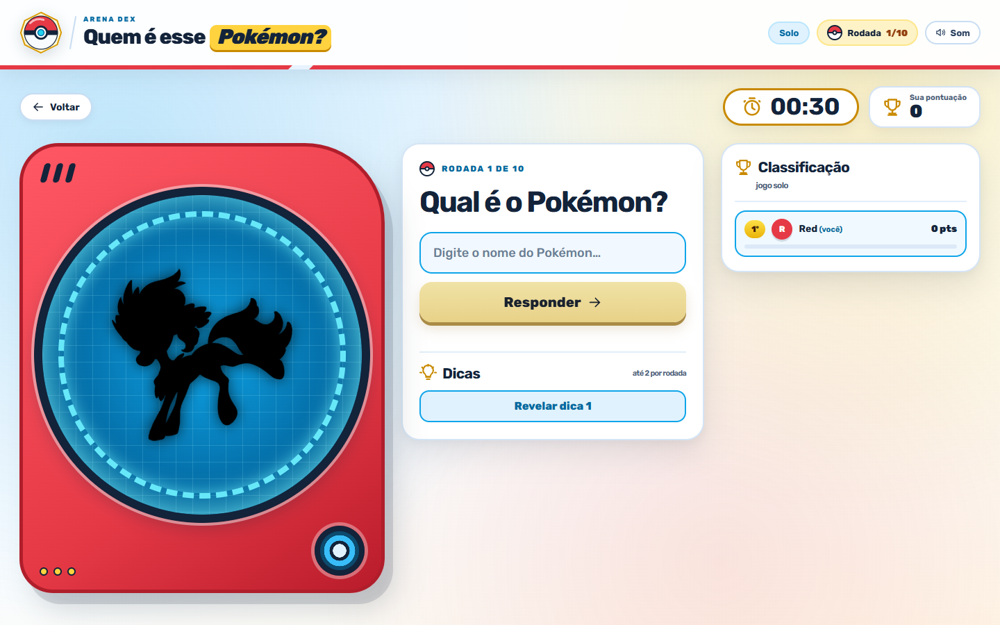
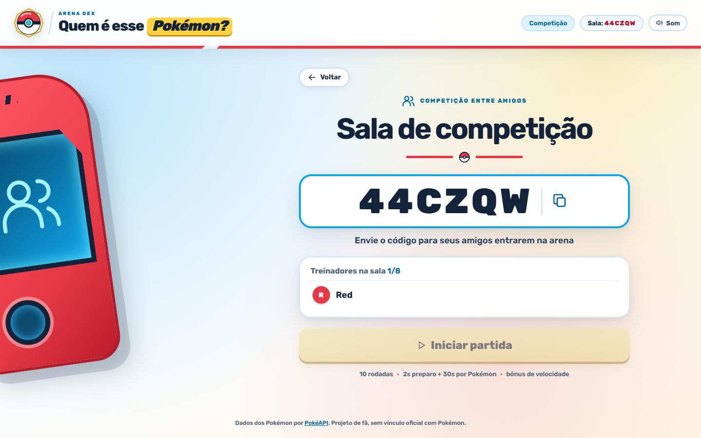

# Arena Dex — Quem é esse Pokémon?

Aplicação web responsiva de duelo de silhuetas Pokémon. Jogue sozinho contra a PokéAPI ou crie uma sala de competição em tempo real com até **8 treinadores** usando código de sala.


## Recursos Principais

- **Duelo de Silhuetas em 10 Rodadas**: Pokédex radar com preparo inicial de **2 segundos** antes da liberação do turno + **30 segundos** para responder cada Pokémon.
- **Pontuação por Proximidade & Bônus de Velocidade**:
  - Respostas com pequenos erros de digitação recebem pontuação proporcional por proximidade do nome.
  - Em salas multiplayer, o treinador mais rápido em cada rodada conquista bônus de velocidade no placar.
- **Até 2 Dicas Estratégicas**: dicas sob demanda sobre tipo, altura e peso (com ajuste transparente de pontuação).
- **1ª a 9ª Geração (1–1025)**: filtre por geração específica ou jogue com toda a Pokédex nacional.
- **Efeitos Sonoros Sintetizados (Web Audio API)**: feedback sonoro para cliques, acertos, erros e revelação (com botão de silenciar no cabeçalho).
- **Multiplayer Seguro e Temporário**: salas com código de acesso de até 2 horas no Redis (sem necessidade de cadastro). A resposta nunca é enviada ao cliente antes da revelação.

## Telas do Sistema

| Arena de Jogo (Silhueta & Classificação) | Sala de Competição Multiplayer |
| --- | --- |
|  |  |

<details>
<summary>Visualização Mobile Responsiva</summary>


</details>

## Arquitetura & Stack

- **Frontend**: HTML5, CSS3 responsivo (tema claro Pokédex + wallpaper SVG), JavaScript Vanilla (`app.js`), Web Audio API.
- **Backend / Serverless Functions (Vercel)**: Endpoints em Node.js (`api/room.js`, `api/image.js`) para gerenciamento de salas, cálculo autoritativo de pontuação e proxy de silhuetas com `sharp`.
- **Persistência**: Upstash Redis em produção (com fallback em memória automático para desenvolvimento local via `scripts/dev-server.mjs`).

## Rodando Localmente

Requer **Node.js 20+** (Node.js 26 na Vercel).

```bash
npm ci
npm run dev
```

Acesse `http://localhost:3001`. Sem variáveis de ambiente configuradas, o servidor local utiliza armazenamento em memória automaticamente.

### Variáveis de Ambiente para Produção (Vercel + Upstash Redis)

Configure `.env.local` (local) ou as Environment Variables na Vercel:

```dotenv
UPSTASH_REDIS_REST_URL=https://seu-banco.upstash.io
UPSTASH_REDIS_REST_TOKEN=seu-token
```

### Testes Automatizados

```bash
npm test
```

Valida pontuação exata/por proximidade, bônus de velocidade, preparo de turno, autenticação de sessão anônima, rate limiting, proxy de silhuetas e fluxo completo de UI.

---

Publicado originalmente em [pokemon.gabrieldagostim.com](https://pokemon.gabrieldagostim.com/). Dados e sprites por [PokéAPI](https://pokeapi.co/) e [PokeAPI/sprites](https://github.com/PokeAPI/sprites). Projeto de fã sem vínculo oficial com Pokémon.
